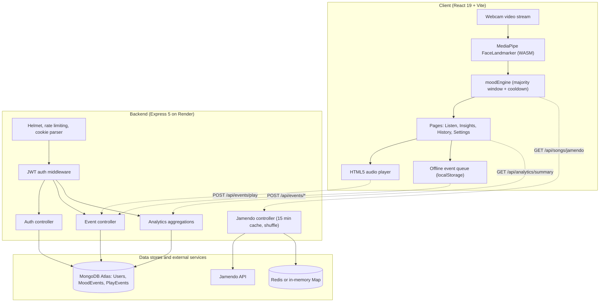
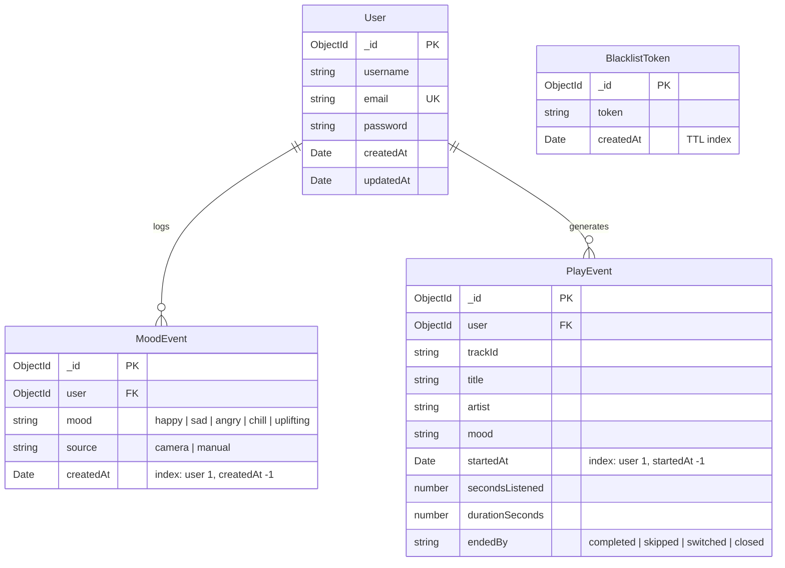

# Mood Melodies

Plays music that matches your facial expression. The camera runs in your browser, a mood is estimated from facial movement, and tracks for that mood stream from Jamendo. Every mood change and every play is saved, so the Insights page shows what you actually listen to and when.

**Live demo:** https://mood-melodies-pi.vercel.app

The backend runs on a free tier, so the first request after a quiet period can take up to a minute.


**No camera?** Choose a mood manually on the Listen page. To see the analytics without waiting days for data, log in with the demo account (seeded with 30 days of sample events):

- Email: `demo@moodmelodies.com`
- Password: `demo1234`

[Features](#features) · [Tech stack](#tech-stack) · [How mood estimation works](#how-mood-estimation-works) · [Design decisions](#design-decisions) · [Privacy and security](#privacy-and-security) · [Limitations](#limitations) · [Architecture](#architecture) · [Data model](#data-model) · [API](#api-endpoints) · [Run locally](#run-locally) · [Tests](#tests) · [Deployment](#deployment) · [Troubleshooting](#troubleshooting)

---

## Features

- **In-browser expression estimation.** MediaPipe FaceLandmarker runs as WebAssembly in the browser. Video frames never leave the device.
- **Stable mood changes.** A sliding window of samples decides the mood. A single frame, a blink or a lost face does not change the playlist.
- **Five moods:** `happy`, `sad`, `angry`, `chill` (neutral) and `uplifting` (surprised).
- **Manual override.** A native select changes the mood immediately and skips the cooldown.
- **Event logging.** Mood changes (`MoodEvent`) and plays with listen time and skip behaviour (`PlayEvent`) are saved per user. Failed requests wait in a `localStorage` queue and are sent on the next load. `navigator.sendBeacon` ends the current play when the tab closes.
- **Insights page** (`/insights`): tracks played, listening time, most frequent mood, skip rate, mood distribution, a 7 by 24 weekday and hour grid, daily listening, skip rate by mood and top artists. Hours are shown in your own timezone.
- **History page** with paginated tables, CSV export and a "Delete my data" action.
- **Settings:** autoplay, sensitivity, timezone and camera on or off.

## Tech stack

| Area | Tools |
|---|---|
| Frontend | React 19, Vite, SCSS (design tokens), react-router, Recharts, lucide-react |
| Backend | Node.js, Express 5, Mongoose, zod, helmet, express-rate-limit |
| Data | MongoDB Atlas, Redis (optional, in-memory fallback) |
| Face estimation | MediaPipe FaceLandmarker (WASM, in the browser) |
| Music | Jamendo API |
| Tests | `node:test` (backend), Vitest (frontend) |
| Hosting | Vercel (frontend), Render (backend) |

## How mood estimation works

1. The webcam feed is sampled about 5 times per second.
2. MediaPipe returns facial blendshape scores for each sample. These are mapped to an expression label:

   | Facial movement | Label | Mood tag |
   |---|---|---|
   | Smile | happy | `happy` |
   | Frown | sad | `sad` |
   | Brows pulled down | angry | `angry` |
   | Relaxed face | neutral | `chill` |
   | Mouth open, brows up | surprised | `uplifting` |

3. Labels go into a sliding window. The mood changes only if one label holds at least 60% of the window.
4. Automatic changes are at least 20 seconds apart. The sensitivity setting shortens or lengthens both the window and this cooldown.
5. "No face in frame" is shown as a status. It never changes the mood and is never logged.
6. A mood is logged only when the stable mood changes or the user overrides it, never on page load.

The logic lives in `Frontend/src/features/expression/utils/moodEngine.js` as pure functions with no React, so it can be unit tested.

## Design decisions

- **Events live in their own collections.** The first version pushed every mood into an array on the user document. That loaded and saved the whole document on every log and grew without limit. `MoodEvent` and `PlayEvent` are indexed by user and time instead.
- **A mood change needs agreement, not one frame.** Without the window and cooldown, a blink or a lost face reloaded the playlist.
- **Plain POST instead of WebSocket.** Data only flows from the client to the server, so there is nothing to push. A retry queue and `sendBeacon` cover flaky connections and tab closes.
- **Timezone-aware analytics.** Events are stored in UTC. The weekday and hour grid is grouped with `$dateToParts` in the user's IANA timezone, so "evening" means the user's evening.
- **Jamendo results are cached for 15 minutes per mood** (Redis, or an in-memory Map when Redis is not configured). A mood change does not always cost an API call.
- **Plain UI on purpose.** One accent colour, system font, 1px borders, tables instead of cards, no emoji. Colours are CSS variables in `Frontend/src/styles/tokens.scss`, with a dark theme through `prefers-color-scheme`.

## Privacy and security

- Video is processed in the browser and never uploaded. The server stores only mood labels, track details and timestamps.
- Users can export all their events as CSV and delete them from the History page.
- Passwords are hashed with bcrypt. The JWT is stored in an httpOnly cookie, and logout blacklists the token.
- `helmet`, rate limiting (auth routes 20 requests per 15 minutes, other routes 300) and `zod` validation on every endpoint.
- Error responses never include stack traces.

## Limitations

- **Facial movement is a rough proxy.** The app estimates surface expressions from facial movement. It does not measure how you feel.
- **Lighting and angle matter.** Dim light, low-resolution webcams, glasses glare, hands over the face or a tilted head can make the detector report "No face in frame".
- **Catalog.** Music comes from Jamendo's Creative Commons catalog. Genres and tag accuracy vary by track.
- **Cross-domain cookies.** In production the frontend (Vercel) and backend (Render) are on different domains, so the auth cookie uses `SameSite=None; Secure`. Browsers that block third-party cookies will not keep you logged in.
- **Cold starts.** The free backend tier sleeps when idle. The app shows a "Server is starting" message after a few seconds of waiting.

---

## Architecture



## Data model



A play counts as skipped when the user moves to another track before 30 seconds have been listened to.

## API endpoints

All endpoints except register and login need the auth cookie.

| Method | Endpoint | Description |
|---|---|---|
| `POST` | `/api/auth/register` | Create an account (`username`, `email`, `password`). |
| `POST` | `/api/auth/login` | Check credentials and set the `token` httpOnly cookie. |
| `POST` | `/api/auth/logout` | Clear the cookie and blacklist the active token. |
| `GET` | `/api/auth/me` | Current user, with totals computed from events. |
| `POST` | `/api/events/mood` | Log a mood change (`mood`, `source`). |
| `POST` | `/api/events/play` | Log the start of a track (`trackId`, `title`, `artist`, `mood`, `durationSeconds`). |
| `POST` | `/api/events/play/:id/end` | Finish a play (`secondsListened`, `endedBy`). Works with `sendBeacon`. |
| `GET` | `/api/events/history` | Paginated history (`type=mood\|play`, `from`, `to`, `page`, `limit`). |
| `GET` | `/api/events/export` | All of the user's events as CSV. |
| `DELETE` | `/api/events/me` | Delete all of the user's events (`confirm=true`). |
| `GET` | `/api/analytics/summary` | Aggregated stats (`range=7d\|30d\|90d`, `tz=<IANA timezone>`). |
| `GET` | `/api/songs/jamendo` | Tracks for a mood, cached for 15 minutes and shuffled. |

The summary response contains `totals`, `moodDistribution`, `moodByHour`, `dailyListening`, `skipRateByMood` and `topArtists`.

## Project structure

```
Mood Melodies
├── Backend
│   ├── src
│   │   ├── config          database, cache (Redis or memory)
│   │   ├── controllers     auth, events, analytics, jamendo
│   │   ├── middlewares     auth, validation
│   │   ├── models          User, MoodEvent, PlayEvent
│   │   ├── routes
│   │   └── app.js
│   ├── scripts             migrate-mood-history.js, seed-demo-data.js
│   └── .env.example
└── Frontend
    ├── src
    │   ├── features
    │   │   ├── expression  camera hook, detector, moodEngine
    │   │   └── home        player, queue, pages
    │   └── styles          tokens.scss
    └── .env.example
```

## Environment variables

### Backend (`Backend/.env`)

| Variable | Description | Example |
|---|---|---|
| `PORT` | Local server port | `3000` |
| `MONGO_URI` | MongoDB connection string | `mongodb://127.0.0.1:27017/moodmelodies` |
| `JWT_SECRET` | Secret used to sign tokens | a long random string |
| `CLIENT_URL` | Frontend origin for CORS | `http://localhost:5173` |
| `JAMENDO_CLIENT_ID` | Client ID from developer.jamendo.com | `your_jamendo_client_id` |
| `REDIS_URL` | Optional. The in-memory Map is used when absent | `redis://localhost:6379` |
| `NODE_ENV` | `development` or `production` | `development` |

### Frontend (`Frontend/.env`)

| Variable | Description | Example |
|---|---|---|
| `VITE_API_URL` | URL of the backend | `http://localhost:3000` |

Restart the Vite dev server after changing a `VITE_` variable.

## Run locally

**Prerequisites:** Node.js 18 or newer, a MongoDB instance (local or Atlas) and a free Jamendo client ID.

```bash
# Backend
cd Backend
cp .env.example .env      # fill in the values
npm install
npm run dev

# Frontend (second terminal)
cd Frontend
cp .env.example .env
npm install
npm run dev
```

Open http://localhost:5173 and allow camera access when asked.

**Sample data:** to fill a demo user with 30 days of events so Insights has something to show:

```bash
cd Backend
npm run seed:demo
```

**Existing data from the first version:** if you have old entries in `User.moodHistory`, copy them into `MoodEvent` once (safe to run again):

```bash
cd Backend
node scripts/migrate-mood-history.js
```

## Tests

```bash
cd Backend && npm test      # node:test
cd Frontend && npm test     # Vitest
```

What is covered:

- `moodEngine`: window majority, cooldown, ignored "no face" samples and the effect of sensitivity.
- Analytics helpers: range parsing, zero-filling of daily totals and timezone validation.

The MongoDB aggregation pipelines and the camera pipeline are checked by hand, not by automated tests.

## Deployment

- **Frontend (Vercel):** set `VITE_API_URL` to the Render URL.
- **Backend (Render):** set the variables from the table above. `CLIENT_URL` must be the exact Vercel origin, without a trailing slash, or CORS requests fail.
- **Cookies:** with different domains the auth cookie needs `SameSite=None; Secure`, which is set when `NODE_ENV=production`.
- **Cold start:** Render's free tier sleeps when idle. The first request can take up to a minute.

## Troubleshooting

| Problem | What to check |
|---|---|
| Camera does not start | Allow camera access in the browser's site settings. The page must be on `localhost` or HTTPS. |
| "No face in frame" most of the time | Face the light, keep your face fully in view, and remove anything covering it. |
| No music plays | Check that `JAMENDO_CLIENT_ID` is set and the backend is reachable. |
| Login works locally but not in production | Allow third-party cookies for the site, and check `CLIENT_URL` and `NODE_ENV=production` on the backend. |
| First load is very slow | The backend is waking up on the free tier. Wait about a minute and retry. |
| Frontend ignores a changed `.env` value | Variables must start with `VITE_`, and the dev server needs a restart. |

## Roadmap

- Use skip rate per mood to rank tracks, so recommendations improve over time.
- Per-user calibration of the neutral face, since resting expressions differ between people.
- Weekly summary view in Insights.
- Better layout checks on small phones.

## Screenshots

### Listen


Player, queue, and the camera panel with expression status and mood source.

### Insights


Stat blocks, mood distribution, weekday and hour grid, daily listening, skip rate by mood and top artists.

### History


Mood and play tables with date filters, CSV export and data deletion.

### Settings


Autoplay, sensitivity, timezone and camera controls.

## Credits

- Music from [Jamendo](https://www.jamendo.com). Each track is under its own Creative Commons license, so check the license before reusing a track outside this app.
- Face landmarks and blendshapes from [MediaPipe](https://ai.google.dev/edge/mediapipe/solutions/vision/face_landmarker).

## Author

Chandan Kumar Sharma · [GitHub](https://github.com/chandan-sharma07) · [LinkedIn](https://www.linkedin.com/in/chandansharma07/)

## License

MIT. Add a `LICENSE` file to the repository root.